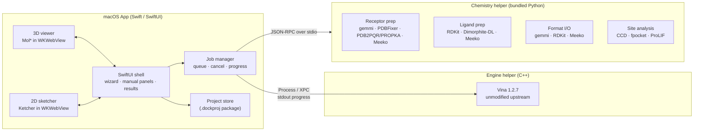

# macOS Molecular Docking App — Product & Technical Plan (v2)

> **Working name:** _TBD_ (do not use "AutoDock" or "Vina" in the product name — see §16)
> **Engine:** AutoDock Vina 1.2.7 (Apache-2.0), unmodified
> **Platforms:** macOS 14+ (Apple Silicon native, Intel supported)
> **Status:** Planning draft — items marked **[VERIFY]** must be confirmed before implementation or release.

---

## Table of Contents

1. [Product Vision & Principles](#1-product-vision--principles)
2. [Scientific Foundation](#2-scientific-foundation)
3. [Requirements](#3-requirements)
4. [System Architecture](#4-system-architecture)
5. [Protein Preparation](#5-protein-preparation)
6. [Ligand Preparation](#6-ligand-preparation)
7. [File Formats & Conversion](#7-file-formats--conversion)
8. [Binding Site Detection](#8-binding-site-detection)
9. [Guided & Manual Workflow (UX)](#9-guided--manual-workflow-ux)
10. [Results Analysis](#10-results-analysis)
11. [Export & Reporting](#11-export--reporting)
12. [Scientific Validation & Benchmarks](#12-scientific-validation--benchmarks)
13. [Testing & Quality Assurance](#13-testing--quality-assurance)
14. [Reproducibility & Provenance](#14-reproducibility--provenance)
15. [Build, Packaging & Distribution](#15-build-packaging--distribution)
16. [Licensing & Legal](#16-licensing--legal)
17. [Business Model](#17-business-model)
18. [Roadmap](#18-roadmap)
19. [Risk Register](#19-risk-register)
20. [Open Decisions](#20-open-decisions)
21. [References](#21-references)

---

## 1. Product Vision & Principles

### Vision
A native macOS docking workstation that takes a researcher from a raw PDB ID or file to **validated, reproducible, publication-ready docking results**. It offers a guided "click and run" path for newcomers and full manual control for experts.

### Value proposition
Vina itself is free. Customers pay for:

| Value | How it shows up |
|---|---|
| **Correct preparation** | Expert-reviewed protein and ligand prep with documented defaults |
| **Confidence** | Built-in redocking validation and a published benchmark |
| **Speed to result** | Guided workflow, automatic pocket and box detection |
| **Reproducibility** | Project files that replay runs exactly, plus auto-generated Methods text |
| **Native experience** | Apple Silicon performance, drag and drop, dark mode, local-only data |

### Non-negotiable principles
1. **Engine fidelity.** The docking engine is upstream Vina with zero scientific modifications. Results must match the official build (§12.1).
2. **No silent science.** Every transformation of user data is logged, shown in a report, and reversible by re-running with different options.
3. **Defaults are claims.** Every default has a written rationale and a citation where one exists (§5, §6).
4. **Honest scoring.** Scores are labelled "predicted binding affinity (Vina score, kcal/mol)", never "binding free energy" or "ΔG".
5. **Local-first.** User structures never leave the machine unless the user explicitly fetches from or submits to a public database.
6. **Reproducible by default.** Seeds, versions and parameters are always recorded.

---

## 2. Scientific Foundation

> This section corrects the v1 plan. In Vina the rotatable-bond term is a **divisor**, not an additive term.

### 2.1 Vina scoring function (Trott & Olson 2010)

For each pair of atoms *i, j* (inter-molecular, and intra-molecular pairs separated by more than three consecutive covalent bonds), the surface distance is

```
d_ij = r_ij − R_i − R_j
```

where *r* is the interatomic distance and *R* are van der Waals radii for the X-Score atom types. Pairs are evaluated up to a cutoff of 8 Å.

| Term | Functional form | Weight |
|---|---|---|
| gauss1 | `exp(−(d/0.5)²)` | −0.035579 |
| gauss2 | `exp(−((d−3)/2)²)` | −0.005156 |
| repulsion | `d²` if `d < 0`, else 0 | 0.840245 |
| hydrophobic | 1 if `d < 0.5`; linear to 0 at `d = 1.5` (hydrophobic pairs only) | −0.035069 |
| hydrogen bond | 1 if `d < −0.7`; linear to 0 at `d = 0` (donor–acceptor pairs only) | −0.587439 |

The intermolecular sum is then divided by a torsional factor:

```
score = Σ weighted_terms_inter / (1 + w_rot · N_rot),   w_rot = 0.05846
```

`N_rot` is the number of active rotatable bonds (torsions) in the ligand.

**Other scoring functions exposed:**
- **Vinardo** (Quiroga & Villarreal 2016): re-parameterized, simplified Vina terms with different atomic radii.
- **AutoDock4.2** (Morris et al. 2009): force-field terms (vdW, H-bond, electrostatics, desolvation). It needs grid maps from AutoGrid4; see the licensing note in §16.

### 2.2 Search algorithm
- **Iterated local search (Monte Carlo + BFGS):** randomly perturb position, orientation or one torsion, then minimize locally with quasi-Newton BFGS. Accept or reject with a Metropolis criterion.
- **Exhaustiveness** is the number of independent Monte Carlo runs, executed in parallel threads.
- **Grid acceleration:** inter-molecular terms are precomputed on a 3D grid. The default spacing is 0.375 Å.
- **Clustering:** the final poses are filtered by `min_rmsd` (default 1.0 Å) and an energy window (`energy_range`, default 3 kcal/mol). Up to `num_modes` poses are kept (default 9).

### 2.3 Vina 1.2 capabilities to expose
- Simultaneous docking of multiple ligands
- Flexible receptor side chains
- Macrocycle flexibility (through Meeko preparation)
- Hydrated docking (explicit-water protocol)
- AutoDock4Zn force field for zinc metalloproteins
- Python bindings (not used in production; see §4)

### 2.4 Known scientific limitations (shown in the app)
- Scores correlate only moderately with experimental affinity. They are for ranking and enrichment, not absolute ΔG.
- No covalent docking in v1.
- Metal coordination, halogen bonds and cation–π interactions are poorly modelled by the Vina function.
- A rigid receptor cannot capture induced fit. Use flexible residues or ensemble docking instead.
- Results depend strongly on protonation and tautomer choices. This is why preparation is shown in detail.

---

## 3. Requirements

### 3.1 Functional requirements

| ID | Requirement | Priority |
|---|---|---|
| F-01 | Import receptor from file, PDB ID (RCSB), or AlphaFold DB (UniProt ID) | P0 |
| F-02 | Import ligands from file, SMILES, name lookup (PubChem), or sketcher | P0 |
| F-03 | Protein preparation pipeline (§5) | P0 |
| F-04 | Ligand preparation pipeline (§6) | P0 |
| F-05 | Multi-format import and export (§7) | P0 |
| F-06 | Co-crystal ligand detection and pocket residue display (§8) | P0 |
| F-07 | Automatic box from ligand, pocket or residues; interactive 3D box editing | P0 |
| F-08 | Vina, Vinardo and AD4 scoring; all Vina CLI parameters | P0 |
| F-09 | Guided mode with per-step option cards, plus full manual mode (§9) | P0 |
| F-10 | Run, cancel, progress, time estimate | P0 |
| F-11 | Redocking validation with RMSD report | P0 |
| F-12 | Results: pose table, 3D view, interaction analysis, 2D diagram (§10) | P0 |
| F-13 | Project file with full provenance; exact replay (§14) | P0 |
| F-14 | Methods paragraph and citation export | P1 |
| F-15 | Pocket prediction for apo structures (fpocket) | P1 |
| F-16 | Batch virtual screening with results dashboard | P1 |
| F-17 | Flexible side chains, multi-ligand docking, hydrated docking | P1 |
| F-18 | Ensemble docking (multiple receptor conformations) | P2 |
| F-19 | PDF report generation | P1 |
| F-20 | AutoDock4Zn for zinc sites | P2 |

### 3.2 Non-functional requirements

| ID | Requirement | Target |
|---|---|---|
| N-01 | Engine equivalence with official Vina 1.2.7 | §12.1 criteria; 100% of the equivalence suite passes |
| N-02 | Reproducibility | Same project + same app version + same architecture ⇒ identical output |
| N-03 | Responsiveness | UI never blocks; all science runs out of process |
| N-04 | Crash isolation | An engine or prep crash never crashes the UI; the error is shown with logs |
| N-05 | Cancellation | Any job cancels within 2 s; partial outputs are clearly marked |
| N-06 | Privacy | No telemetry of molecular data; network use is only explicit fetches |
| N-07 | Performance | Native arm64; thread count configurable (defaults to performance cores) |
| N-08 | Accessibility | VoiceOver labels, keyboard navigation, colour-blind-safe interaction colours |
| N-09 | Large structures | mmCIF support; receptors up to at least 100k atoms load in under 3 s **[VERIFY target on hardware]** |

---

## 4. System Architecture

### 4.1 Process model



### 4.2 Why separate processes
- **Cancellation:** Vina has no in-process cancel API. Terminating a child process is clean and immediate.
- **Crash isolation:** a malformed input that crashes RDKit or Vina cannot take down the UI.
- **Parallel batch:** run N engine processes with a bounded total thread budget.
- **Fidelity:** the engine binary is built from upstream exactly as the official CLI is, so equivalence testing compares like with like.
- **Licensing hygiene:** LGPL and GPL tools stay in separate executables (§16).

### 4.3 Components

| Component | Technology | Responsibility |
|---|---|---|
| UI shell | SwiftUI + AppKit where needed | Workflow, forms, tables, state |
| 3D viewer | Mol* (MIT) in `WKWebView` | Cartoon, surface, ligands, box gizmo, interactions |
| Sketcher | Ketcher (Apache-2.0) in `WKWebView` | Draw ligands, export molfile/SMILES |
| Job manager | Swift concurrency + `Process` | Spawn, monitor, cancel, retry; bounded concurrency |
| Engine helper | Vina 1.2.7 CLI built from source | Docking and scoring |
| Chemistry helper | Relocatable Python env | Prep, conversion, analysis |
| Project store | File package (directory bundle) | Inputs, intermediates, outputs, provenance |

### 4.4 Chemistry helper protocol
- JSON-RPC 2.0 over stdin/stdout. Each request carries a `job_id`.
- Every response contains `result`, `warnings[]`, `provenance{tool, version, params}` and `artifacts[]` (file paths inside the project).
- Long operations emit `progress` notifications.
- **Errors are typed:** `InvalidInput`, `UnsupportedFeature`, `ToolFailure` and `Cancelled`, each with a human-readable message and the raw tool log attached.

### 4.5 Canonical data model
Formats convert **through** one internal model, never directly from one format to another:

- **Macromolecule:** a gemmi `Structure`, keeping chains, residues, altlocs, occupancy, B-factors and HETATM classification.
- **Small molecule:** an RDKit `Mol` with explicit bond orders, formal charges, stereo and 3D conformers.
- **Docking-ready:** Meeko molecule setup → PDBQT. Meeko's mapping is kept so poses can be converted back to bond-order-correct SDF.

### 4.6 Project package (`.dockproj`)
```
MyProject.dockproj/
├── project.json            # schema-versioned manifest, all parameters, seeds
├── provenance.jsonl        # append-only log of every operation
├── inputs/                 # original user files, untouched, with SHA-256
├── receptor/               # prepared receptor stages + prep report
├── ligands/                # prepared ligands + per-ligand prep reports
├── runs/<run-id>/          # config, stdout log, poses (PDBQT + SDF), scores
└── reports/                # PDF/HTML reports, methods text, exports
```

---

## 5. Protein Preparation

### 5.1 Pipeline and defaults

| # | Stage | Guided default | Manual options | Tool | Rationale |
|---|---|---|---|---|---|
| 1 | Fetch / load | — | PDB, mmCIF, PDBQT, AlphaFold | gemmi | mmCIF is the canonical archive format |
| 2 | Model selection | Model 1 (NMR) | Any model | gemmi | — |
| 3 | Chain selection | Chains within 5 Å of the selected ligand; otherwise all protein chains | Manual pick | gemmi | Avoids docking into crystal-packing interfaces |
| 4 | Altlocs | Highest occupancy (first on tie) | Per-residue choice | gemmi | Standard practice |
| 5 | Waters | Remove all | Keep waters within *X* Å of the ligand, or keep a selected set | gemmi | Vina is calibrated without explicit waters |
| 6 | HETATM handling | Remove additives (§8.1); keep metals and cofactors in the site | Per-molecule checklist | gemmi + CCD | Cofactors shape the pocket |
| 7 | Non-standard residues | Map to standard (MSE→MET, etc.) | Keep, map or remove | PDBFixer | — |
| 8 | Missing heavy atoms | Rebuild missing side-chain atoms | Off | PDBFixer | Incomplete side chains distort contacts |
| 9 | Missing loops | Flag only; warn if within 10 Å of the site | Model short loops (≤ N residues) | PDBFixer | Modelled loops are speculative and must be explicit |
| 10 | Protonation | pH 7.4 with PROPKA pKa | pH value; per-residue His (HID/HIE/HIP), Asp/Glu/Lys/Cys states | PDB2PQR + PROPKA | Physiological pH; pKa-aware states |
| 11 | Amide/His flips | Optimize Asn/Gln/His flips | Accept or reject each flip | Reduce or PDB2PQR **[VERIFY tool choice]** | Corrects crystallographic ambiguity |
| 12 | Minimization | Off | Restrained minimization (heavy atoms restrained) | OpenMM | Off by default to preserve crystal coordinates |
| 13 | PDBQT | Vina atom types | AD4 charges; flexible residues split into rigid/flex files | Meeko `mk_prepare_receptor` | Official Vina toolchain |

### 5.2 Prep Report (shown and saved with every run)
- A table of every change: residue, change, reason and tool.
- **Warnings:**
  - missing loops near the site
  - occupancy < 1 in the site
  - B-factor outliers in the site
  - steric clashes after hydrogen placement
  - unusual protonation (for example a buried charged residue)
  - metals present (Vina handles them crudely)
- Before/after atom counts and net charge.

### 5.3 AlphaFold-specific handling
- Show pLDDT colouring. Warn when pocket residues have pLDDT < 70.
- Offer trimming of low-confidence termini.
- Note: no co-crystal ligand exists, so route the user to pocket prediction (§8.3).

---

## 6. Ligand Preparation

### 6.1 Pipeline and defaults

| # | Stage | Guided default | Manual options | Tool |
|---|---|---|---|---|
| 1 | Input | — | SDF, MOL2, MOL, SMILES, PDB/mmCIF (CCD lookup for bond orders), sketcher, PubChem name or CID | RDKit, gemmi |
| 2 | Sanitize | RDKit sanitization; report failures | Keep failures out of the batch | RDKit |
| 3 | Standardize | Strip salts and solvents, keep largest fragment, neutralize | Each step toggleable | RDKit MolStandardize |
| 4 | Protonation | Dominant state at pH 7.4 | pH range; enumerate states (cap N) | Dimorphite-DL |
| 5 | Tautomers | Keep input tautomer | Canonical tautomer; enumerate (cap N) | RDKit |
| 6 | Stereo | Keep defined stereo; enumerate undefined centres (cap N) | Off / enumerate all | RDKit |
| 7 | 3D generation | ETKDGv3 embedding + MMFF94 minimization (fixed seed) | Multiple conformers; UFF fallback | RDKit |
| 8 | Docking setup | Meeko defaults; flexible macrocycles on | Rigid macrocycles; custom rigid bonds; hydrated mode | Meeko |
| 9 | Checks | Torsion count warning; unsupported elements; boron and metals | — | RDKit, Meeko |

If a ligand already has 3D coordinates from a crystal structure, preserve them. This is needed for redocking RMSD (§8.4).

### 6.2 Property panel
- MW, cLogP, HBD, HBA, TPSA, rotatable bonds, QED
- Lipinski and Veber pass/fail
- PAINS and Brenk structural alerts, shown as flags, not as filters by default

### 6.3 Library mode
- Accepts multi-molecule SDF or SMILES files.
- Removes duplicates by InChIKey.
- Shows a per-molecule status table: prepared, warning or failed, with the reason.
- Failed molecules never disappear silently. They are listed and exportable.

---

## 7. File Formats & Conversion

### 7.1 Support matrix

| Format | Import | Export | Library | Notes |
|---|---|---|---|---|
| PDB | ✅ | ✅ | gemmi | Legacy; 99,999-atom limit |
| mmCIF / PDBx | ✅ | ✅ | gemmi | Required for large entries |
| PDBQT | ✅ | ✅ | Meeko | Docking format; no bond orders |
| SDF / MOL (V2000, V3000) | ✅ | ✅ | RDKit | Preferred ligand format |
| MOL2 | ✅ | ✅ | RDKit (import); writer **[VERIFY; RDKit has no MOL2 writer]** | Many legacy tools depend on it |
| SMILES / SMI | ✅ | ✅ | RDKit | 2D only; 3D generated on import |
| XYZ | ✅ | ✅ | RDKit | Bond perception needed on import, with a warning |
| PQR | ✅ | ✅ | PDB2PQR | Charges + radii |
| Complex PDB/mmCIF (receptor + pose) | — | ✅ | gemmi | For PyMOL, ChimeraX, Maestro |
| PyMOL `.pml`, ChimeraX `.cxc` | — | ✅ | Templates | Scene scripts that load exported files |
| CSV / XLSX results | — | ✅ | — | Scores, properties, RMSD, interactions |
| PNG / SVG images | — | ✅ | Mol*, RDKit | 3D snapshots, 2D diagrams |
| PDF report | — | ✅ | — | §11 |

### 7.2 Conversion rules
1. Every conversion goes through the canonical model (§4.5).
2. **Lossy conversions warn** before export, for example:
   - PDBQT → SDF without a Meeko mapping (bond orders inferred)
   - XYZ import (bonds perceived)
   - PDB export of more than 99,999 atoms
3. **Docked poses** are written to SDF using Meeko's PDBQT→RDKit reconstruction, so bond orders, charges and hydrogens are correct.
4. Round-trip tests are required for every supported pair (§13).

---

## 8. Binding Site Detection

### 8.1 HETATM classification
Every HETATM group is classified with the PDB Chemical Component Dictionary (CCD) and curated lists:

| Class | Examples | Default action |
|---|---|---|
| Ligand of interest | Drug-like, non-polymer, ≥ N heavy atoms | Offered as reference ligand |
| Cofactor | HEM, NAD, FAD, ATP, SAM | Keep if in site; ask |
| Metal ion | ZN, MG, MN, FE, CA | Keep if in site; warn |
| Crystallization additive | SO4, PO4, GOL, EDO, PEG, ACT, DMS, MPD, CL | Remove |
| Glycan | NAG, MAN, BMA | Keep (part of the structure) |
| Modified residue | MSE, SEP, TPO | Treated as polymer (§5) |
| Water | HOH | §5 stage 5 |

The additive list is versioned and documented. Users can override any classification.

### 8.2 Pocket from a co-crystal ligand
- **Pocket residues:** any atom within **5.0 Å** (default; adjustable 3–8 Å) of any ligand heavy atom.
- **Display:** residues as sticks plus labels; surface clipped to the pocket; interactions as dashed lines.
- **Auto box:** centred on the ligand's heavy-atom centroid; size = ligand extent on each axis + **2 × 4 Å padding**, minimum 15 Å per side **[VERIFY defaults against literature and redocking benchmarks]**.
- **Multiple copies:** if the ligand appears in several chains, list them all and let the user pick one. Default to the copy with the best density fit if that information is available, otherwise the first chain.

### 8.3 Pockets without a ligand
| Method | Use |
|---|---|
| **fpocket** (MIT) | Geometry-based prediction; show ranked pockets with scores |
| Homolog ligand transfer | Find PDB entries of the same UniProt ID that have ligands, superpose, transfer the site **[P2]** |
| Residue-defined site | User selects residues; box fitted around them |
| Blind docking | Box covers the whole protein; force higher exhaustiveness; strong warning |

### 8.4 Redocking validation
1. Extract the co-crystal ligand with CCD bond orders and keep its crystal pose as the reference.
2. Prepare it through the normal ligand pipeline. Its conformation is randomized before docking, so the result isn't biased by the starting pose.
3. Dock with the user's protocol.
4. Compute **symmetry-corrected heavy-atom RMSD** of each pose against the crystal pose (RDKit `CalcRMS`).
5. Report the top-1 RMSD and the best RMSD among the top N.
   - **Green:** top-1 ≤ 2.0 Å.
   - **Amber:** a pose ≤ 2.0 Å exists but isn't ranked first.
   - **Red:** no pose ≤ 2.0 Å.
6. Store the result in the project and in the Methods text.

---

## 9. Guided & Manual Workflow (UX)

### 9.1 Modes
- **Guided mode:** a step-by-step wizard. Each step shows 2–5 **option cards**. One card is marked **Recommended** with a one-line reason and a "Learn more" popover.
- **Manual mode:** every parameter is exposed in collapsible panels with no wizard. It includes a live preview of the equivalent Vina config file and command line.
- Users can switch modes at any time without losing state. Each step also has an **Advanced** disclosure, so guided users can open expert options for that step only.

### 9.2 Steps

| Step | Option cards (★ = recommended when applicable) |
|---|---|
| **1. Target** | Fetch by PDB ID ★ · AlphaFold model · Upload file · Open recent project |
| **2. Protein prep** | Standard prep ★ · Custom prep · Already prepared (skip, validate only) |
| **3. Binding site** | Co-crystal ligand ★ (if present) · Predicted pocket ★ (if apo) · Select residues · Blind docking · Manual box |
| **4. Receptor flexibility** | Rigid ★ · Flexible side chains (pick up to N residues) · Ensemble (multiple structures) |
| **5. Ligands** | Single molecule · Library / virtual screen · Draw · Use co-crystal ligand (redock) |
| **6. Ligand prep** | Standard prep at pH 7.4 ★ · Enumerate states · Use as-is |
| **7. Docking engine** | Vina ★ · Vinardo · AD4 — then a preset: Fast (exh. 8) · Standard (exh. 32) ★ · Thorough (exh. 64+) |
| **8. Validation** | Redock reference ligand ★ (if available) · Skip |
| **9. Run** | Progress per ligand, ETA, pause queue, cancel |
| **10. Results** | Pose table · 3D · Interactions · Compare to reference |
| **11. Export** | Formats · Report · Methods text |

### 9.3 Guardrails (warnings; never block)

| Condition | Message |
|---|---|
| Search space > 27,000 ų | Large box: increase exhaustiveness or narrow the site (Vina prints the same warning) |
| Blind docking at exhaustiveness < 32 | Blind docking is under-sampled at this setting |
| Ligand centroid outside box | The ligand starts outside the search space |
| Receptor has no hydrogens | The receptor isn't prepared; polar hydrogens are needed |
| Metals in site with Vina scoring | Metal interactions are poorly modelled; consider AD4Zn for zinc |
| Missing residues near site | The pocket may be incomplete |
| High torsion count | Search may be unreliable; consider more exhaustiveness |
| Redocking red | The protocol failed to reproduce the crystal pose; results are unreliable |

### 9.4 UX details
- Drag and drop files anywhere; the app routes them to receptor or ligand by content, not extension.
- The 3D box can be edited by handles in the viewer, by numeric fields, or by "fit to selection".
- Every step has an undo history.
- Dark mode, full keyboard navigation, VoiceOver labels.

---

## 10. Results Analysis

- **Pose table:** rank, Vina score, RMSD lower/upper bound from the best pose (Vina output), RMSD to reference (if any), ligand efficiency (score / heavy atoms).
- **3D view:** toggle poses, overlay reference ligand, show pocket surface.
- **Interactions** (ProLIF, Apache-2.0): H-bonds, hydrophobic, π–π, cation–π, salt bridge, halogen bond, metal. Each is listed per residue and drawn in 3D.
- **2D interaction diagram:** RDKit-based ligand depiction with interacting residues. Evaluate PoseView-like layouts **[VERIFY a license-compatible approach]**.
- **Screening dashboard:** sort and filter by score, LE, properties and interaction fingerprints. Cluster hits by scaffold (Bemis–Murcko).
- **Physical plausibility check:** PoseBusters (BSD-3) on the top poses, flagging clashes, bad geometry and stereo changes.

---

## 11. Export & Reporting

- **Files:** any format in §7.1; poses individually or as a multi-pose SDF.
- **Report (PDF/HTML):**
  - target and preparation summary
  - protein and ligand prep reports
  - box definition
  - parameters and seeds
  - redocking validation
  - results table
  - 3D snapshots and interaction diagrams
  - software versions
- **Methods text:** generated from the actual run parameters, with citations. Example:
  > Receptor 1ABC was prepared at pH 7.4 (PROPKA 3.x) … docking was performed with AutoDock Vina 1.2.7 [refs] using exhaustiveness 32, a 22 × 20 × 24 Å box centred on the co-crystal ligand … Redocking of the native ligand reproduced the crystal pose with an RMSD of 0.84 Å.
- **Citation export:** BibTeX and RIS for every tool used in the run.

---

## 12. Scientific Validation & Benchmarks

This is what makes the product "publication grade". Every release must pass §12.1 and §12.2. §12.3 is run for major releases and published.

### 12.1 Engine equivalence (every build)
- **Reference:** the official Vina 1.2.7 release binary, plus a reference build from upstream source with documented compiler flags.
- **Suite:** about 50 diverse complexes × {Vina, Vinardo, AD4} × {rigid, flexible} × fixed seeds; plus `--score_only` and `--local_only` cases.
- **Pass criteria:**
  - Same architecture, same compiler settings: **identical** pose coordinates and scores.
  - Across architectures (arm64 vs x86_64): score of the top pose within ±0.1 kcal/mol, and statistical equivalence over seeds. Any divergence is measured and documented **[VERIFY behaviour; floating-point contraction can differ by architecture]**.
  - `--score_only` on fixed poses: scores match to printed precision.

### 12.2 Preparation reference set (every release)
- 50–100 PDB entries chosen for diversity (kinases, proteases, GPCRs, metalloenzymes, nuclear receptors, cofactor-dependent enzymes), prepared by hand and reviewed by an expert computational chemist.
- **Compared against the app's output:**
  - chain and HETATM decisions
  - His tautomers and titratable states
  - flips
  - ligand bond orders and formal charges
  - atom-type assignment in PDBQT
- **Pass:** 100% on bond orders and charges of reference ligands. Documented and justified agreement on protonation (expected disagreement where pKa is borderline).

### 12.3 Published benchmarks (major releases)

| Benchmark | Measures | Metric | Notes |
|---|---|---|---|
| CASF-2016 (285 complexes) | Docking power, scoring power | Top-1 success at RMSD ≤ 2 Å; Pearson R | **[VERIFY commercial license of PDBbind/CASF]** |
| PoseBusters benchmark set | Pose accuracy + physical validity | % RMSD ≤ 2 Å and PB-valid | Open dataset **[VERIFY license]** |
| DUD-E (102 targets) | Screening enrichment | EF1%, ROC-AUC, BEDROC | Known decoy bias, so report with caveats |
| DEKOIS 2.0 (81 targets) | Screening enrichment | EF1%, ROC-AUC | — |
| LIT-PCBA (15 targets) | Realistic screening | EF1% | Hard and unbiased |

**Two tracks, both reported:**
1. **Engine-only:** use the inputs exactly as prepared in the published Vina 1.2 study. Results must match the published values within statistical noise.
2. **End-to-end:** start from raw PDB/CCD and use the app's guided defaults. This is the number customers actually experience.

**Deliverables:**
- A public validation whitepaper with full methods and data.
- A peer-reviewed application note (target journals: *J. Cheminformatics*, *JCIM*, *Bioinformatics*).
- Scripts and inputs released so third parties can reproduce the benchmark.

### 12.4 Scientific governance
- A **scientific advisor** (a computational chemist) signs off on every default in §5, §6 and §8, and on the benchmark design.
- **Default change policy:** any change to a scientific default requires a benchmark re-run, a changelog entry, and a project-file migration note.

---

## 13. Testing & Quality Assurance

| Layer | What | Tooling |
|---|---|---|
| Unit (Swift) | View models, job manager, project schema | XCTest |
| Unit (Python) | Every prep stage, classifiers, converters | pytest |
| Golden files | Prep outputs for the reference set; byte-stable where deterministic | pytest + checked-in expected outputs |
| Round-trip | Every format pair in §7: atoms, bond orders, charges, stereo, coordinates | pytest + RDKit comparisons |
| Engine equivalence | §12.1 suite | CI job comparing against the reference binary |
| Fuzzing | PDB, mmCIF, SDF, MOL2 and PDBQT importers with malformed inputs | Hypothesis / atheris |
| Integration | Wizard end-to-end on 10 representative targets | XCUITest + scripted helpers |
| Lifecycle | Cancel during prep, during docking and during export; crash recovery; disk full | Integration tests |
| Performance | Load time, prep time, docking throughput on M-series and Intel | Benchmark CI job; track regressions |
| Manual QA | Release checklist covering the guided path on 5 targets | Checklist in repo |

**CI gates for a release:** all unit and golden tests, the equivalence suite, round-trip tests, a fuzzing smoke test, and the notarization check.

---

## 14. Reproducibility & Provenance

- **Provenance record per artifact:** inputs (SHA-256), tool name and version, parameters, seed, timestamp, app version, architecture.
- **Deterministic seeds:** user-visible and recorded. Default is a random seed that is shown and saved, never hidden.
- **Exact replay:** "Re-run from project" reproduces outputs on the same app version and architecture, and verifies the checksums.
- **Version pinning:** the chemistry environment is locked (exact package versions plus a lockfile). Its version is part of the app version.
- **Project migration:** schema-versioned `project.json`. Older projects open read-only with a migration offer, and the original is never overwritten.

---

## 15. Build, Packaging & Distribution

### 15.1 Engine
- Build Vina 1.2.7 from upstream source with CMake.
- **Boost:** build as static, separately for arm64 and x86_64 (Homebrew Boost is single-architecture), then combine with `lipo`.
- Record compiler version and flags in the build manifest. Use the same flags for the reference build in §12.1.

### 15.2 Chemistry environment
- Relocatable Python, using python-build-standalone or a conda environment packed with conda-pack **[VERIFY: RDKit, OpenMM and PDBFixer wheel/conda availability for both architectures]**.
- Pin every package. Generate an SBOM (software bill of materials).
- Strip tests and docs to reduce size. Measure the final bundle size.

### 15.3 Signing & distribution
- Sign every binary and every `.so`/`.dylib` in the bundle. Enable the hardened runtime with only the entitlements actually needed.
- Notarize and staple. Verify with `spctl` and `codesign --verify --deep --strict` in CI.
- **Channel:** a direct download (notarized DMG) with a licensing and payment platform, such as Paddle or Lemon Squeezy, plus Sparkle for updates.
- The Mac App Store is deferred: its sandbox constraints on bundled interpreters and helper executables need investigation **[VERIFY]**.

### 15.4 Network use
- Network access only for explicit fetches: RCSB, AlphaFold DB, PubChem, update checks and licence activation.
- Offline mode is fully functional with local files.

---

## 16. Licensing & Legal

### 16.1 Dependency license audit (to be confirmed by counsel)

| Component | License | Commercial use | Integration |
|---|---|---|---|
| AutoDock Vina | Apache-2.0 | ✅ with attribution and NOTICE | Separate executable |
| Boost | BSL-1.0 | ✅ | Static link into engine |
| RDKit | BSD-3 | ✅ | Chemistry helper |
| Meeko | LGPL-2.1 **[VERIFY]** | ✅ when kept replaceable | Chemistry helper (Python, unmodified) |
| gemmi | MPL-2.0 | ✅ file-level copyleft on modifications | Chemistry helper |
| PDBFixer / OpenMM | MIT (OpenMM: parts LGPL) **[VERIFY]** | ✅ | Chemistry helper |
| PDB2PQR | BSD-3 **[VERIFY]** | ✅ | Chemistry helper |
| PROPKA | LGPL-2.1 **[VERIFY]** | ✅ when kept replaceable | Chemistry helper |
| Reduce | **[VERIFY]** | **[VERIFY]** | Separate executable |
| Dimorphite-DL | Apache-2.0 | ✅ | Chemistry helper |
| ProLIF | Apache-2.0 | ✅ | Chemistry helper |
| PoseBusters | BSD-3 | ✅ | Chemistry helper |
| fpocket | MIT | ✅ | Separate executable |
| Mol* | MIT | ✅ | Web view |
| Ketcher | Apache-2.0 | ✅ | Web view |
| AutoGrid4 (for AD4 maps) | **[VERIFY — may be GPL]** | Separate executable only, or make AD4 optional | Separate executable |
| Open Babel | GPL-2.0 | ⚠️ Avoid in a closed-source app | **Not used** |
| PLIP | GPL-2.0 | ⚠️ Avoid | **Not used** |

### 16.2 Obligations
- Ship all license texts and NOTICE files in the app (*About → Acknowledgements*).
- For LGPL components: ship them unmodified, keep them user-replaceable, and provide source or offer it.
- Ask users to cite the underlying tools (Methods export does this automatically).

### 16.3 Trademarks and claims
- Don't use "AutoDock" or "Vina" in the product name, logo or domain. Use "Powered by AutoDock Vina" with attribution.
- Marketing claims must point to §12 benchmark results. No "more accurate than Vina" claims without data.
- **Disclaimer:** for research use only; not for clinical or diagnostic decisions.

### 16.4 Data and privacy
- No molecular data leaves the device except explicit public-database fetches.
- The licence activation service sends only licence identifiers.
- Publish a privacy policy.

---

## 17. Business Model

| Tier | Audience | Includes | Price model |
|---|---|---|---|
| **Academic** | Students, academic labs | Full single-ligand workflow, validation, reports | Free or low annual price; academic email verification |
| **Pro** | Individual researchers, small biotechs | + batch screening, ensemble docking, PDF reports | Annual subscription or perpetual + updates |
| **Commercial / Team** | Companies | + team licences, priority support, validation documentation pack | Per-seat annual |

**Go-to-market:**
- Publish the validation paper.
- Beta with 3–5 academic labs.
- Tutorials reproducing well-known published docking studies.
- Presence at conferences (ACS, Gordon conferences) and on YouTube.

**Support:** a documented knowledge base, a scientific FAQ explaining the limitations, and email support for paid tiers.

---

## 18. Roadmap

Each phase ends only when its exit criteria are met. Durations are estimates for one or two developers plus part-time scientific review.

| Phase | Scope | Exit criteria | Est. |
|---|---|---|---|
| **0. Foundations** | Engine build (universal), equivalence harness, chemistry helper skeleton, project format, CI | §12.1 suite passes on both architectures; helper runs RPC round-trip | 4–6 wk |
| **1. MVP** | Load PDBQT/PDB/SDF, Mol* viewer, manual box, Vina run with cancel/progress, pose table, export | Dock and export a known complex end to end; results match the CLI | 6–8 wk |
| **2. Preparation** | Protein prep (§5), ligand prep (§6), format matrix (§7), prep reports | §12.2 reference set passes; round-trip tests pass | 8–10 wk |
| **3. Sites & validation** | HETATM classification, pocket residues, auto box, redocking, interactions | Redocking runs on the reference set; interactions verified manually on 10 complexes | 5–6 wk |
| **4. Guided mode** | Full wizard (§9), guardrails, Methods text, reports | Usability test: a novice completes a redocking in under 10 minutes without help | 5–6 wk |
| **5. Screening** | Batch mode, dashboard, fpocket, PoseBusters | 10k-ligand screen completes with failures isolated | 4–6 wk |
| **6. Benchmark & launch** | §12.3 benchmarks, whitepaper, signing and notarization, licensing platform, website | Benchmarks within expected range; licence audit signed off; notarized release | 6–8 wk |
| **7. Post-launch** | Flexible side chains UI, ensemble docking, AD4Zn, hydrated docking, homolog site transfer, Metal/GPU exploration | Per feature | — |

**Indicative total to commercial v1.0:** about 9–12 months.

---

## 19. Risk Register

| Risk | Likelihood | Impact | Mitigation |
|---|---|---|---|
| Cross-architecture numeric differences | Medium | Medium | Measure early (Phase 0); document; match flags with the reference build |
| Python bundle size and signing complexity | High | Medium | Prototype packaging in Phase 0; strip unused packages |
| Benchmark dataset licensing blocks publication | Medium | High | Confirm licences in Phase 0; prefer open datasets (PoseBusters, DEKOIS) |
| Prep defaults disputed by reviewers or customers | Medium | High | Scientific advisor sign-off; expose all choices; publish rationale |
| GPL contamination via a dependency | Low | High | Licence audit gate in CI (SBOM + licence scanner) |
| Upstream Vina changes or bugs | Low | Medium | Pin versions; track upstream issues; equivalence suite catches drift |
| Users over-interpret scores | High | Medium | Labelling, guardrails, limitations page, redocking validation |
| Market: free alternatives (PyRx, AutoDock Tools, Chimera) | High | Medium | Differentiate on prep quality, validation, reproducibility and native UX |

---

## 20. Open Decisions

| # | Decision | Options | Needed by |
|---|---|---|---|
| D-1 | Product name and trademark search | — | Phase 1 |
| D-2 | Python packaging approach | python-build-standalone vs conda-pack | Phase 0 |
| D-3 | Flip optimization tool | Reduce vs PDB2PQR | Phase 2 |
| D-4 | AD4 scoring support given AutoGrid licensing | Ship separately / optional download / omit | Phase 2 |
| D-5 | Default box padding and minimum size | Benchmark-driven | Phase 3 |
| D-6 | 2D interaction diagram approach | RDKit custom / other licensed component | Phase 3 |
| D-7 | Pricing and academic verification | — | Phase 6 |
| D-8 | Mac App Store feasibility | — | Post-launch |

---

## 21. References

> Confirm all citations against the publishers' records before using them in the app or the paper.

1. Trott O, Olson AJ. AutoDock Vina: improving the speed and accuracy of docking with a new scoring function, efficient optimization, and multithreading. *J Comput Chem.* 2010;31(2):455–461.
2. Eberhardt J, Santos-Martins D, Tillack AF, Forli S. AutoDock Vina 1.2.0: New docking methods, expanded force field, and Python bindings. *J Chem Inf Model.* 2021;61(8):3891–3898.
3. Quiroga R, Villarreal MA. Vinardo: a scoring function based on AutoDock Vina improves scoring, docking, and virtual screening. *PLoS One.* 2016;11(5):e0155183.
4. Morris GM, et al. AutoDock4 and AutoDockTools4: automated docking with selective receptor flexibility. *J Comput Chem.* 2009;30(16):2785–2791.
5. Su M, et al. Comparative assessment of scoring functions: the CASF-2016 update. *J Chem Inf Model.* 2019;59(2):895–913.
6. Buttenschoen M, Morris GM, Deane CM. PoseBusters: AI-based docking methods fail to generate physically valid poses or generalise to novel sequences. *Chem Sci.* 2024;15:3130–3139.
7. Mysinger MM, et al. Directory of Useful Decoys, Enhanced (DUD-E). *J Med Chem.* 2012;55(14):6582–6594.
8. Bauer MR, et al. Evaluation and optimization of virtual screening workflows with DEKOIS 2.0. *J Chem Inf Model.* 2013;53(6):1447–1462.
9. Tran-Nguyen VK, Jacquemard C, Rognan D. LIT-PCBA: an unbiased data set for machine learning and virtual screening. *J Chem Inf Model.* 2020;60(9):4263–4273.
10. Olsson MHM, et al. PROPKA3: consistent treatment of internal and surface residues in empirical pKa predictions. *J Chem Theory Comput.* 2011;7(2):525–537.
11. Jurrus E, et al. Improvements to the APBS biomolecular solvation software suite (PDB2PQR). *Protein Sci.* 2018;27(1):112–128.
12. Le Guilloux V, Schmidtke P, Tuffery P. Fpocket: an open source platform for ligand pocket detection. *BMC Bioinformatics.* 2009;10:168.
13. Sehnal D, et al. Mol* Viewer: modern web app for 3D visualization and analysis of large biomolecular structures. *Nucleic Acids Res.* 2021;49(W1):W431–W437.
14. Bouysset C, Fiorucci S. ProLIF: a library to encode molecular interactions as fingerprints. *J Cheminform.* 2021;13:72.
15. Ropp PJ, et al. Dimorphite-DL: an open-source program for enumerating the ionization states of drug-like small molecules. *J Cheminform.* 2019;11:14.
16. Eastman P, et al. OpenMM 8: molecular dynamics simulation with machine learning potentials. *J Phys Chem B.* 2024;128(1):109–116.
17. Wojdyr M. GEMMI: a library for structural biology. *J Open Source Softw.* 2022;7(73):4200.
18. RDKit: Open-source cheminformatics. https://www.rdkit.org
19. Meeko: preparation of small molecules for AutoDock. https://github.com/forlilab/Meeko
20. Jumper J, et al. Highly accurate protein structure prediction with AlphaFold. *Nature.* 2021;596:583–589.
